# Hi I'm Airsado 👋



```text
Working hard.
```

## 🌱 Languages and Tools

| HTML5 | CSS3 | JavaScript | TypeScript | Go | Dart |
|:--:|:--:|:--:|:--:|:--:|:--:|
|  |  |  |  |  |  |

| Tailwind |
|:--:|
|  |

## 🎋 Framework

| Flutter | Spring | Vue |
|:--:|:--:|:--:|
|  |  |  |

